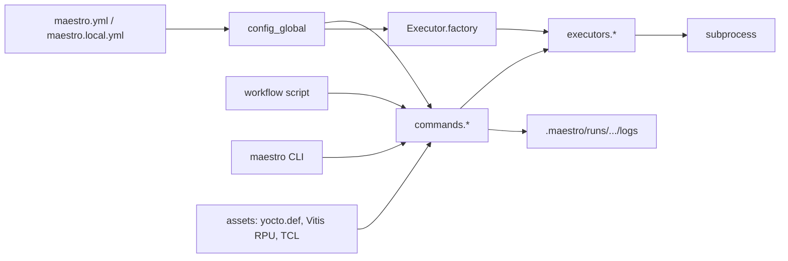

<!--
SPDX-FileCopyrightText: 2026 Maestro authors and contributors
SPDX-FileContributor: Cedric Hirschi <cedr02@live.com>
SPDX-FileContributor: Tim Frey <timfreyb@gmail.com>

SPDX-License-Identifier: Apache-2.0
-->

# Architecture

Maestro splits "what to run" from "how to run it".

## Layers

### Config

Importing `maestro.config_global` (or calling `setup_logging`) loads dataclass
defaults, then `maestro.yml`, then `maestro.local.yml` from the invocation
directory. Derived paths live under `.maestro/` (runs, caches).

### Commands

Classes such as `GitCommands` and `HoGCommands` subclass `Commands`. They own a
`CommandConfig` (cwd, env, isolation and silence flags) and an `Executor`. Public methods
build argv lists and call `self.run(...)`, which delegates to the executor and
writes a per-tool log file for the run.

The executor is `executor=` if one is passed. Otherwise it is built from the id
bound to the command in `maestro.yml` (`executor_id=` overrides the binding).
See [Executors](executors.md).

### Executors

Executors start the actual process:

| Executor | Role |
|---|---|
| `BaseExecutor` | Host process (default) |
| `UVExecutor` | Prefix with `uv run` (typical for `embgen`) |
| `DockerExecutor` | Run in a Docker image, with bind mounts |
| `ApptainerExecutor` | Build/run a SIF from a `.def`, with bind mounts |
| `BashExecutor` / `PrefixExecutor` | Shell or fixed argv prefix |

Swap executors on a command instance without changing the high-level API. For
example, pass an `ApptainerExecutor` into `YoctoCommands` to run Yocto in a
container, or use `UVExecutor` with `EmbGenCommands`.

### CLI

`maestro` (also `meastro`, `mao`) discovers every `*Commands` class and builds
`maestro <tool> <method> --arg ...` subcommands from signatures and docstrings.
See [CLI](../cli.md).

### Assets

Packaged helpers under `maestro.assets`:

- Apptainer definition: `apptainer_def("yocto")`
- Vitis RPU scripts: `VitisCommands.get_builtin("rpu_setup" | "rpu_create" | "rpu_build")`
- Vivado TCL helpers used by `VitisCommands` (program, JTAG AXI, IP packaging)

## Typical call pattern

1. `setup_logging()`
2. Construct command wrappers with `CommandConfig(cwd=...)` when needed
3. Optionally `.configure(...)` an executor and pass it as `executor=`, or bind
   one in `maestro.yml`
4. Call wrapper methods; inspect `CommandResult` or collected artifacts

Tool-specific environment variables (`RPU_*`, `VITIS_*`, `RAUC_*`, ...) are set in
the workflow script via `os.environ`, not via Maestro YAML.
