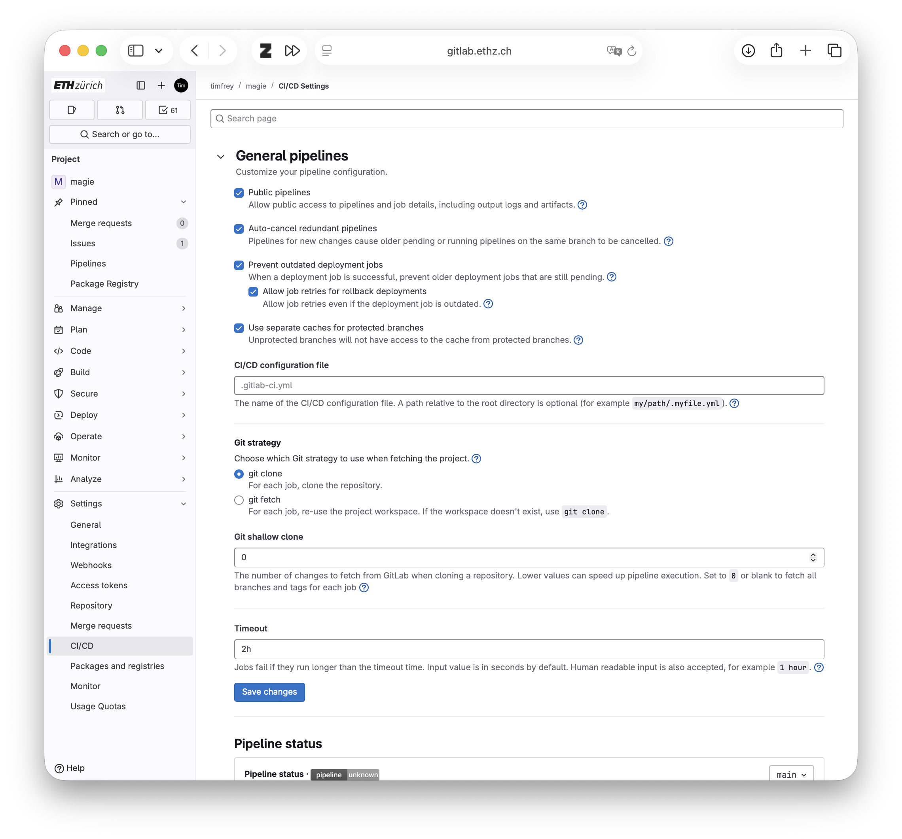

<!--
SPDX-FileCopyrightText: 2026 Maestro authors and contributors
SPDX-FileContributor: Cedric Hirschi <cedr02@live.com>
SPDX-FileContributor: Tim Frey <timfreyb@gmail.com>

SPDX-License-Identifier: Apache-2.0
-->

# GitLab CI/CD Pipeline

Maestro's own checks run in [GitHub Actions](https://github.com/Spare-Logic/maestro/actions).
This guide is for downstream FPGA projects hosted on GitLab.

To set up a GitLab CI/CD pipeline, you need:

- A runner: a machine to execute your jobs
- An environment: e.g. docker image
- A pipeline configuration: `.gitlab-ci.yml`

Below some explanations to get started with CI/CD for a Xilinx FPGA project.

## Runner Setup

### Install
See [https://docs.gitlab.com/runner/install/linux-repository/](https://docs.gitlab.com/runner/install/linux-repository/) to install on your machine

### Register project
On GitLab go to CI/CD settings and register new runner.
On the machine execute the provided snippet
Preferably using docker.

Additional configuration for custom docker.
In the config.toml of the GitLab runner on the machine
```
concurrent = 4
check_interval = 0
connection_max_age = "15m0s"
shutdown_timeout = 0

[session_server]
  session_timeout = 1800

[[runners]]
  name = ...
  url = ...
  token = ...
  executor = "docker"
  environment = ["GIT_CONFIG_COUNT=1", "GIT_CONFIG_KEY_0=safe.directory", "GIT_CONFIG_VALUE_0=*"]
  [runners.cache]
    Type = "local"
    Path = "/cache"
    Shared = true
    MaxUploadedArchiveSize = 0
  [runners.docker]
    tls_verify = false
    image = ...
    memory = "16g"                                                    # update memory
    privileged = false
    disable_entrypoint_overwrite = false                              # disable entrypoint overwrite
    oom_kill_disable = false
    disable_cache = false
    volumes = ["/cache"]
    cache_dir = "/cache"
    allowed_pull_policies = ["always", "if-not-present"]              # set pull policy for local images
    shm_size = 0
    network_mtu = 0
```

### GitLab Pipeline with custom image

Generate an image containing all dependencies including Xilinx Vitis, yocto deps and so forth. Create a cli script to build everything and use it in the pipeline.

Adapt the image, project names, and `inv` tasks to your workflow.
See [templates/gitlab-ci.yml](https://github.com/Spare-Logic/maestro/blob/main/docs/templates/gitlab-ci.yml) as an example.

For custom local images set
```
default:
  image:
    name: vitis_tools_user:2025.2
    pull_policy: if-not-present # available: always, if-not-present
    entrypoint: [""]
```

For pulling private repositories set, this configures the `CI_JOB_TOKEN` to be used with https git requests.
```
  before_script:
    - |
      echo "
      machine $CI_SERVER_HOST
      login gitlab-ci-token
      password $CI_JOB_TOKEN
      " > ~/.netrc
```


### GitLab CI configuration

For HoG and other systems relying on full git history set under `CI/CD` > `General pipelines`

- git strategy: `git clone`
- git shallow clone: `0`
- timeout: at least `2h`



See the [HoG pipeline configuration guide](https://hog.readthedocs.io/en/2026.1/02-User-Manual/02-Hog-CI/03-GitLab-CI/01-setup-CI.html#pipeline-configuration) for more details.
